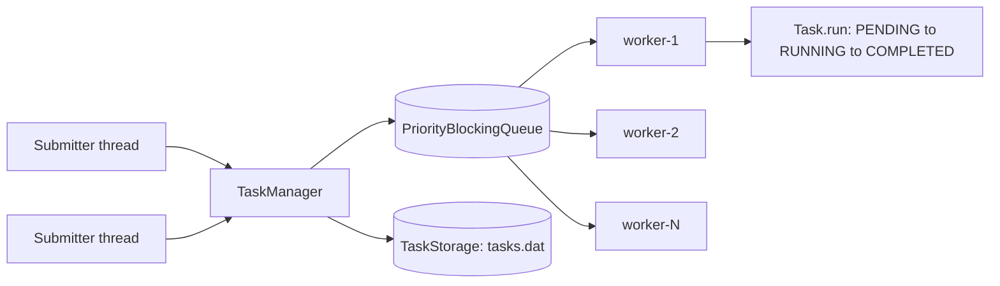

# Multithreaded Task Scheduler

A priority-based task scheduler in plain Java. A fixed pool of worker threads pulls tasks from a thread-safe priority queue, so urgent tasks jump ahead of waiting ones, and every task runs exactly once, even under heavy concurrent submission.

> Runs in a single JVM. It is a concurrency project, not a distributed system.

## Features

- **Priority scheduling:** `HIGH` > `MEDIUM` > `LOW`, strictly first-come, first-served within the same priority.
- **Late arrivals jump the queue:** a `HIGH` task submitted after workers have started still runs before queued `LOW` tasks.
- **Exactly-once execution:** a task can never run twice, even if many threads try to run it at the same time.
- **Safe concurrent submission:** many threads can submit tasks at once.
- **Graceful shutdown:** waits for work to finish, stops the workers, then saves state.
- **Crash-safe persistence:** tasks are saved with an atomic file swap; a corrupt or incompatible save file is moved aside and reported instead of silently ignored.

## Architecture



| Class | Responsibility |
|---|---|
| `Task` | The unit of work. Holds status in an `AtomicReference`; ordering by priority, then a sequence number. |
| `TaskScheduler` | Wraps a `PriorityBlockingQueue` and tracks queued + running tasks so shutdown knows when it is idle. |
| `TaskExecutor` | Starts N long-lived worker loops on an `ExecutorService`; each loop blocks on `take()` for the next best task. |
| `TaskManager` | Public API: submit, start, shutdown, status; loads and saves tasks. |
| `TaskStorage` | Persistence with a write-to-temp-then-atomic-move strategy. |

## Concurrency bugs found and fixed

| Problem in the first version | Fix |
|---|---|
| `PriorityQueue` is not thread-safe, so concurrent submits could corrupt it | `PriorityBlockingQueue` |
| Queue was emptied into the executor once, so priority only applied to the first batch and late tasks never ran | Worker threads pull directly from the priority queue in a loop |
| `status.set(RUNNING)` let two threads run the same task | `compareAndSet(PENDING, RUNNING)` |
| Same-priority order was random; ties used a timestamp, and timestamps collide on Windows | Strictly increasing `AtomicLong` sequence number |
| State was saved while tasks were still running; completed tasks were re-queued on restart | Save only after workers stop; re-queue only unfinished tasks |
| `Executors.newFixedThreadPool` queue is unbounded | Pool runs only N worker loops; the priority queue is the single source of work |

## Tests (JUnit 5)

Each test was verified to **fail** when its fix was removed, then pass when restored.

- `TaskSchedulerTest`: highest priority first, ties first-come, first-served.
- `TaskTest`: 20 threads released at once with a `CountDownLatch` run the same task; it must execute exactly once. Without `compareAndSet` this fails with 20 executions.
- `TaskManagerLoadTest`: 500 tasks from 4 submitter threads with 8 workers; all must complete, each exactly once, under a 30-second `@Timeout`.

Result on my machine: 500/500 completed, each exactly once, in about 0.9 s (8 workers, 10 ms tasks).

## Run it

Requires JDK 17+ and Maven.

```bash
mvn test                                   # run the tests
java -cp target/classes com.taskmanager.Main          # demo: priority + late HIGH tasks
java -cp target/classes com.taskmanager.LoadTestMain  # 500-task load check
```

## Limitations and next steps

- Single process only; scaling across machines would need an external queue (e.g. Kafka) and a shared store.
- Persistence uses Java serialization; a database would be the production choice.
- No retry policy for failed tasks yet.